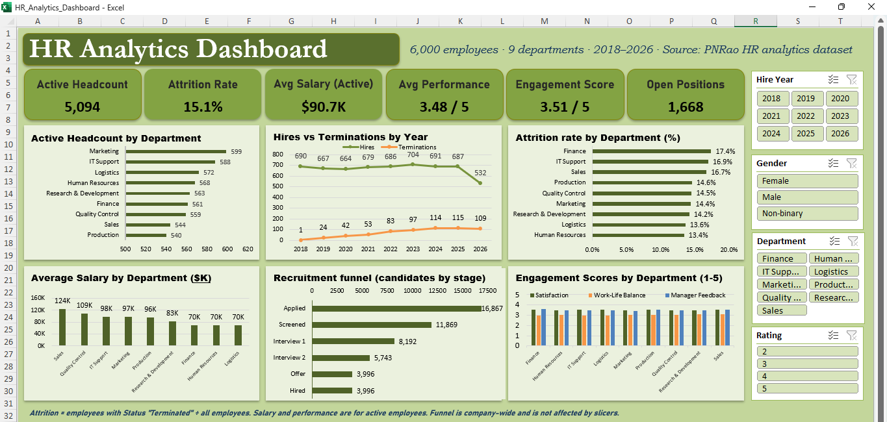

# HR Analytics Dashboard (Excel)

An interactive Excel dashboard that turns a raw 13-sheet HR dataset (6,000 employees, 9 departments, 2018–2026) into clear insights on headcount, attrition, pay, performance, engagement and hiring. This is my first end-to-end data analytics project.

## Objective
To build a dashboard that helps HR and business teams see where people risks sit and filter them by department, gender, performance rating and hire year.

## Key KPIs
| KPI | Value |
|---|---|
| Active Headcount | 5,094 |
| Attrition Rate | 15.1% |
| Avg Salary (Active) | $90.7K |
| Avg Performance | 3.48 / 5 |
| Engagement Score | 3.51 / 5 |
| Open Positions | 1,668 |

## Charts
- Active headcount by department
- Hires vs terminations by year
- Attrition rate by department
- Average salary by department
- Recruitment funnel (candidates by stage)
- Engagement scores by department

## Key Insights
- Finance has the highest attrition (17.4%), followed by IT Support (16.9%) and Sales (16.7%). HR (13.4%) and Logistics (13.6%) have the lowest.
- Sales pays the most (about $124K on average) but still has high attrition, so pay alone doesn't explain people leaving.
- Work-life balance is the lowest engagement score (3.02 / 5) in every department.
- Hiring stayed steady at about 660-700 people a year, while terminations rose from 1 in 2018 to 115 in 2025.
- Of 70,697 candidates tracked, 3,996 were hired (about 5.7%).

## Tools and Skills Used
- Microsoft Excel: Tables, helper columns, PivotTables, Pivot Charts, Data Model
- Slicers (Department, Gender, Performance Rating, Hire Year) connected across multiple PivotTables
- Formulas: INDEX/MATCH, IFERROR, YEAR, TEXT
- KPI cards linked to cells, dashboard layout and design
- Data quality checks and testing

## Method
1. Loaded the 13-sheet dataset and converted the key sheets into Excel Tables.
2. Added helper columns (hire year, active and terminated flags, active salary and performance, survey scores).
3. Built PivotTables on a hidden calculation sheet and Pivot Charts from them.
4. Linked six KPI cards to the calculation sheet.
5. Added slicers and connected each one to every employee PivotTable.
6. Tested all filters and checked the KPI values against the raw data.

## Data Notes
- 292 of the 906 termination dates in the dataset are in the future (up to 2032). I used employee Status as the source of truth, so attrition is the number of employees with Status "Terminated" divided by all 6,000 employees.
- Salary and performance KPIs are for active employees only.
- The recruitment funnel is company-wide and is not affected by the slicers.

## Key Learnings
- Cleaning and structuring data first makes every pivot, chart and slicer easier and more reliable.
- Data Model PivotTables behave differently from normal ones. Direct cell references worked where GETPIVOTDATA failed.
- A slicer only filters the PivotTables it is connected to, so Report Connections need checking.
- Charts built from formulas need fixed lookup ranges, or they show wrong values after filtering.
- Catching data quality issues early, like the future termination dates, protects the accuracy of KPIs.

## Files in this Repository
| File | Description |
|---|---|
| `HR_Analytics_Dashboard.xlsx` | The interactive Excel dashboard |
| `HR_Analytics_Dashboard.pdf` | One-page PDF of the dashboard |
| `HR Dashboard preview.png` | Screenshot of the dashboard |

## How to Use
Download `HR_Analytics_Dashboard.xlsx` and open it in Microsoft Excel (2016 or later). Use the slicers on the right to filter the KPI cards and charts. Use **Clear Filter** on a slicer to reset it.

## Dataset
PNRao HR Analytics sample dataset, downloaded from [blob:https://excelx.com/966e66ee-b39e-4abc-bcd3-b8b045a6a004]. Public data, used here for learning purposes.

## Author
**Bhumi Agarwal**
Aspiring Data Analyst | Agra, India
[LinkedIn](https://www.linkedin.com/in/bhumi-agarwal-7a6a66329/)
